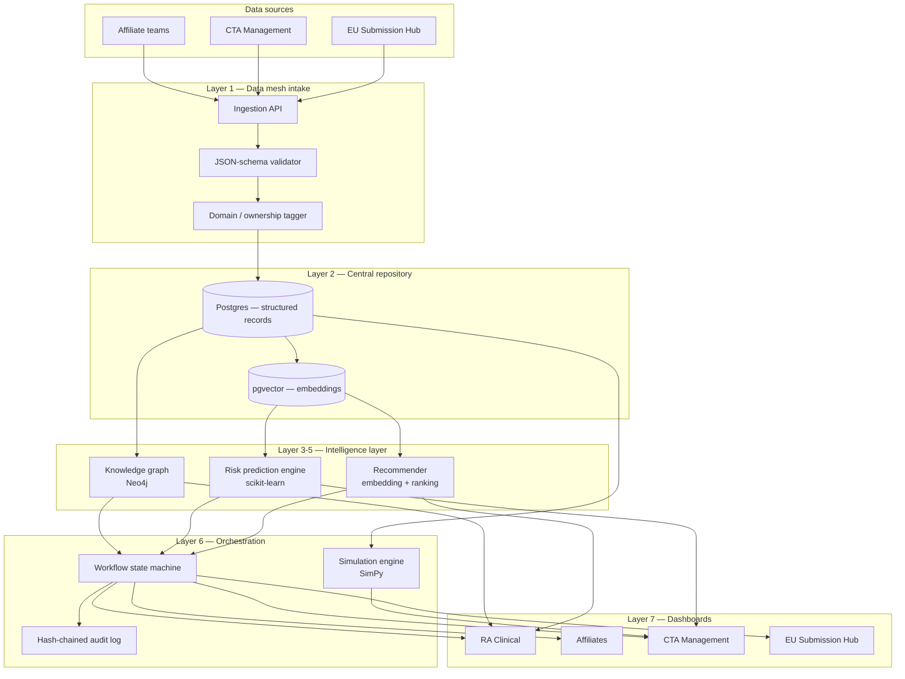
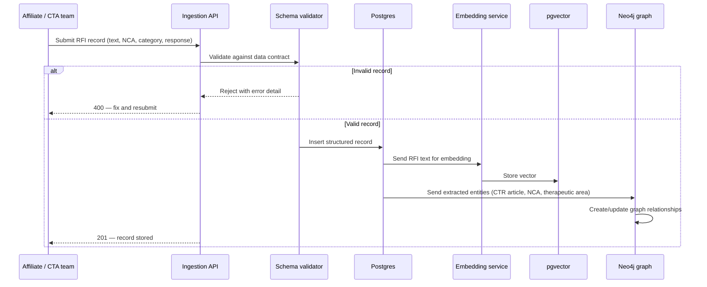
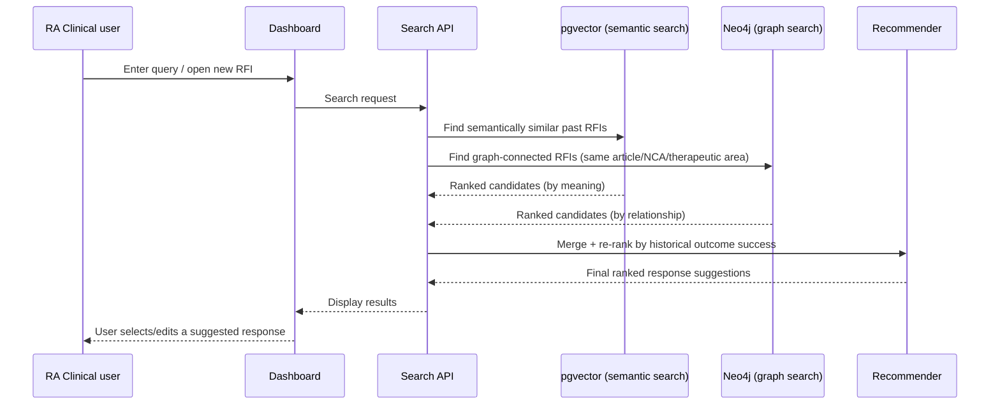
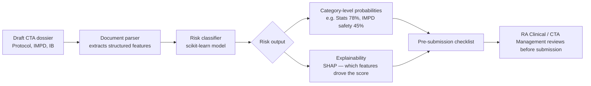
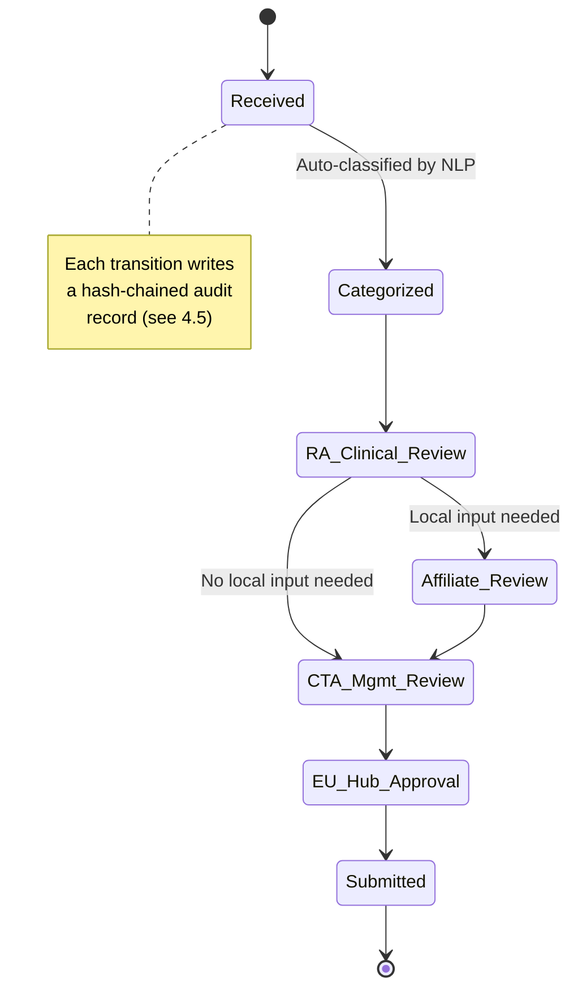
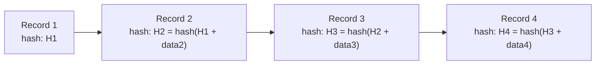
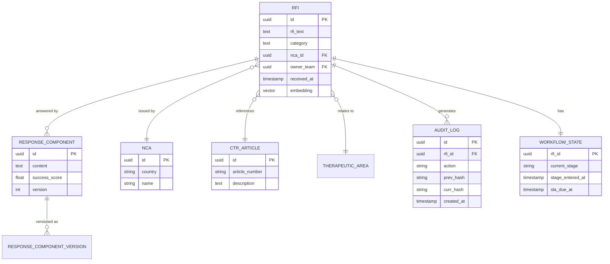
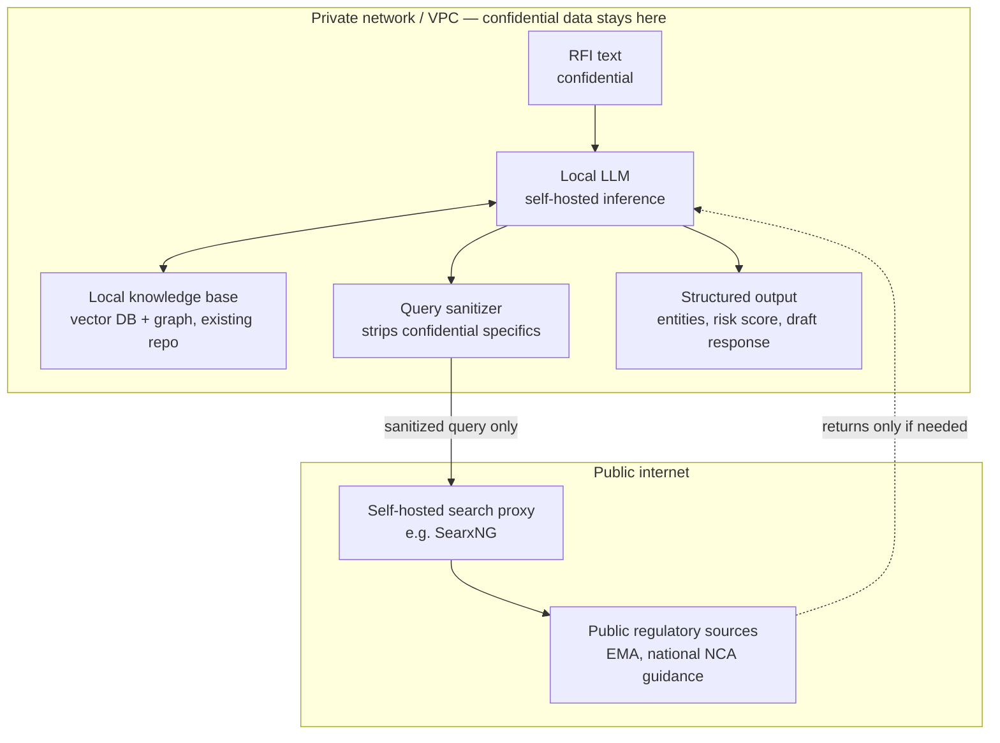

# RFI Nexus — Implementation Guide
### A validation RFI repository & intelligence platform for EU CTR submissions

**Team runway:** ~30 days (4 weeks + buffer)
**Team size assumed:** 4–5 people (Backend, ML/NLP, Graph/Data, Frontend, Product/Domain)

---

## 1. Problem statement recap

Novo Nordisk submits ~650 Clinical Trial Applications (CTAs) a year under the EU Clinical Trials Regulation (CTR). During validation, competent authorities (NCAs) issue Requests for Information (RFIs) — formal questions that must be answered before a trial can proceed. There is currently no central, structured, searchable place to store RFIs and the responses given to them, so the same issues get re-solved from scratch every time, across RA Clinical, Affiliates, CTA Management, and the EU Submission Hub.

**RFI Nexus** solves this with one platform that is simultaneously:
- a **searchable repository** (so nothing gets lost or re-typed),
- a **pattern-detection engine** (so recurring issues become visible),
- a **prediction and drafting assistant** (so quality improves before submission, not after), and
- a **process tracker** (so delays are visible and accountable).

---

## 2. Solution at a glance

RFI Nexus is a layered system. Each layer solves one part of the problem statement and maps to a specific, well-scoped technology — nothing here requires infrastructure you can't stand up from a free tier in a day or two.

| # | Layer | What it does | Problem-statement requirement it satisfies |
|---|-------|--------------|---------------------------------------------|
| 1 | **Data mesh intake** | Validates and tags every RFI record as it enters the system | "Central repository," "structured, reusable format" |
| 2 | **Central repository** | Stores structured records + vector embeddings for meaning-based search | "Central repository," "searchable" |
| 3 | **Knowledge graph** | Links RFIs to CTR articles, NCAs, therapeutic areas, and each other | "Identify recurring issues" |
| 4 | **Risk prediction engine** | Scores a draft CTA dossier for likely RFI triggers *before* submission | "Improve submission quality," "reduce avoidable delays" |
| 5 | **Recommender** | Suggests the best-fit past response components for a new RFI | "Improve submission quality" |
| 6 | **Orchestration layer** (workflow + audit + simulation) | Routes RFIs to the right reviewers, timestamps every step tamper-evidently, and forecasts portfolio-level RFI load | "Reduce avoidable delays," cross-functional support |
| 7 | **Role-based dashboards** | One view per team, filtered to what that team owns | Support for RA Clinical, Affiliates, CTA Management, EU Submission Hub |

---

## 3. Technical architecture

### 3.1 High-level component diagram

### 3.2 Layer-by-layer explanation (in plain terms)

**Layer 1 — Data mesh intake.**
Think of this as airport check-in for data. Before an RFI record is allowed into the system, it's checked against a template (a "schema") — does it have an RFI text, a Member State, a category, a response? If something's missing, it's rejected at the door instead of silently corrupting the database later. Each record also gets a "who owns this" tag (which Affiliate or team submitted it), so access and accountability stay clear even though everything lives in one place.

**Layer 2 — Central repository.**
This is the actual filing cabinet — but a smart one. It stores the structured facts (dates, categories, countries) in normal database tables, *and* it stores a mathematical fingerprint of each RFI's meaning (an "embedding") so the system can find similar RFIs even when the wording is completely different. That second part is what makes search "smart" instead of just keyword-matching.

**Layer 3 — Knowledge graph.**
Instead of a flat spreadsheet, imagine a corkboard with pins for every RFI, every CTR article, every country's regulator, and every therapeutic area — with strings connecting the ones that relate to each other. That's a graph database. It lets you ask questions a spreadsheet can't answer well, like "which article of the regulation causes the most RFIs from German reviewers for oncology trials?" — because the relationships themselves are stored, not just the individual records.

**Layer 4 — Risk prediction engine.**
This is a model trained on your own history: "dossiers that looked like *this* tended to get RFIs about *that*." Before a new CTA is submitted, the system reads the draft and says "there's a 70% chance this triggers a statistics-related RFI" — like a spell-checker, but for regulatory risk instead of typos.

**Layer 5 — Recommender.**
When a new RFI comes in, instead of writing a response from scratch, the system finds the 3–5 most similar RFIs the company has answered before — and ranks them not just by how similar the wording is, but by how well those past responses actually worked (did the NCA accept it, or did it trigger a follow-up question?).

**Layer 6 — Orchestration (workflow + audit + simulation).**
Three sub-parts:
- *Workflow*: a checklist that automatically routes each RFI to the right person/team and tracks how long it's been sitting there, so nothing quietly stalls.
- *Audit trail*: every edit and approval is stamped with a cryptographic fingerprint that includes the fingerprint of the step before it — like a chain of wax seals. If anyone tampered with an old record, the chain would visibly break. This matters because pharma systems need to survive regulatory inspection.
- *Simulation*: a "weather forecast" for RFIs — using historical patterns to estimate how many RFIs of what type to expect next quarter, so teams can staff accordingly.

**Layer 7 — Dashboards.**
Each team (RA Clinical, Affiliates, CTA Management, EU Submission Hub) gets a view scoped to what they need — not a single confusing all-in-one screen.

---

## 4. Detailed data flow diagrams

### 4.1 RFI ingestion flow

### 4.2 Search & recommendation flow

### 4.3 Predictive risk scoring flow

### 4.4 Workflow & audit trail (state machine)

### 4.5 Audit log hash-chaining (concept)

Each new audit entry's hash depends on the previous entry's hash. Change any past record and every hash after it stops matching — tampering becomes instantly detectable without needing a blockchain network, just a chained hash column in Postgres.

### 4.6 Database schema (core entities)

---

## 5. Full tech stack

| Component | Recommended tool | Why this one (in plain terms) |
|---|---|---|
| Backend API | **FastAPI** (Python) | Fast to build, auto-generates API docs, plays well with the Python ML stack |
| Central database | **Supabase** (Postgres) | One tool gives you a database, authentication, and row-level security for free |
| Vector search | **pgvector** (Postgres extension, via Supabase) | Adds "search by meaning" to the same database — no separate vector DB to manage |
| Graph database | **Neo4j AuraDB (free tier)** | Purpose-built for "how are these things connected" queries; free managed hosting |
| Graph visualization | **react-force-graph** | Renders the knowledge graph as an interactive, draggable node diagram in the browser |
| NLP / entity extraction | **Claude API** (Anthropic) | Extracts structured entities (CTR article, NCA, category) from free-text RFIs without training a custom model |
| Embeddings | **Voyage AI** or open-source `sentence-transformers` | Converts RFI text into vectors for semantic search |
| Risk prediction | **scikit-learn** (gradient boosting / logistic regression) | Well-documented, fast to train on a small dataset, easy to explain |
| Explainability | **SHAP** | Shows *why* the model gave a risk score — critical for a regulated environment where "black box" isn't acceptable |
| Recommender | Cosine similarity (pgvector) + a lightweight re-ranking step | Keeps response suggestions relevant *and* weighted by what actually worked before |
| Workflow engine | Custom state machine (Python, config-driven) | Lighter than a full BPM engine like Camunda, but still enforces stages and SLAs |
| Audit trail | SHA-256 hash chain (Python `hashlib`, stored in Postgres) | Tamper-evidence without needing real blockchain infrastructure |
| Simulation | **SimPy** (discrete-event simulation library) | Models the NCA/RFI ecosystem stochastically to forecast portfolio-level load |
| Frontend | **React + Tailwind CSS** | Component-based, fast to style, huge ecosystem of examples |
| Charts | **Recharts** or **Plotly** | For the simulation forecast and risk-score visualizations |
| Auth | Supabase Auth (row-level security tied to team) | Each of the four teams sees only what it should |
| Deployment | **Render** or **Fly.io** (backend) + **Vercel** (frontend) | Free tiers, one-click deploys, live demo URL for judges |
| Synthetic data generation | Claude API, scripted | Generates a realistic ~600-record dataset mimicking the real ~650 CTA/year volume, since real RFI data is confidential |

---

## 6. Step-by-step implementation guide

### Week 1 — Foundation & synthetic data (Days 1–7)
1. **Day 1–2:** Finalize the data contract (JSON schema) for an RFI record: fields, types, required vs. optional. Set up the GitHub repo, branch strategy, and a basic CI pipeline (lint + test on push).
2. **Day 2–3:** Stand up Supabase project (Postgres + pgvector + Auth). Create the core tables from the ERD in section 4.6.
3. **Day 3–5:** Build the synthetic dataset. Use the Claude API to generate ~600 realistic RFI records spanning multiple NCAs, categories (statistics, IMPD safety, informed consent, etc.), and outcomes. This is your demo data — real EU CTR RFI content is confidential, so a well-designed synthetic set is what makes the rest of the system demoable and credible.
4. **Day 5–7:** Scaffold the FastAPI backend and the React frontend (routing, layout, design tokens). Set up Supabase Auth with four role types.

**Deliverable by end of Week 1:** empty-but-working app shell, validated schema, and a realistic dataset ready to load.

### Week 2 — Repository, mesh & graph (Days 8–14)
1. **Day 8–9:** Build the ingestion API (`POST /rfi`) with schema validation and domain-ownership tagging. Load the synthetic dataset through this endpoint (not a raw SQL import) to prove the mesh layer actually works.
2. **Day 9–10:** Generate embeddings for every RFI record and store them in pgvector. Build the semantic search endpoint (`POST /search`).
3. **Day 10–12:** Set up Neo4j AuraDB. Write the entity-extraction pipeline (Claude API) that reads each RFI and pulls out CTR article references, NCA, and therapeutic area, then writes them into the graph as nodes/relationships.
4. **Day 12–14:** Build the graph visualization in the frontend (react-force-graph) and a basic "recurring issues" query — e.g. most common NCA + category pairs, shown as a ranked list.

**Deliverable by end of Week 2:** you can search RFIs by meaning, see a live knowledge graph, and see the first "recurring issue" insights.

### Week 3 — Risk engine, recommender & workflow (Days 15–21)
1. **Day 15–16:** Engineer features from the synthetic dossiers (trial phase, product class, missing sections, etc.). Train and evaluate 2–3 risk classifiers; pick the best; wire up SHAP explainability.
2. **Day 16–17:** Build the "pre-submission checklist" endpoint that takes a draft dossier's features and returns per-category risk probabilities.
3. **Day 17–19:** Build the recommender: given a new RFI, retrieve top-k similar past RFIs (pgvector) and re-rank by historical response success.
4. **Day 19–21:** Implement the workflow state machine (stages from section 4.4), SLA timers, and the hash-chained audit log table with a verification endpoint.

**Deliverable by end of Week 3:** a new RFI can be categorized, risk-scored, matched to suggested responses, and routed through a tracked workflow.

### Week 4 — Simulation, integration & deployment (Days 22–28)
1. **Day 22–23:** Build the SimPy simulation module: calibrate NCA-level RFI-issuance and cycle-time distributions from the synthetic dataset, run Monte Carlo forecasts for the next quarter.
2. **Day 23–24:** Add scenario comparison (baseline vs. a proposed process change) to the simulation, and a forecast chart in the frontend.
3. **Day 24–26:** Build the four role-based dashboards, each surfacing the subset of features relevant to that team (see section 7).
4. **Day 26–28:** Deploy backend (Render/Fly.io) and frontend (Vercel). Run an end-to-end test of the full user journey from a fresh browser session.

**Deliverable by end of Week 4:** a fully integrated, deployed, live-URL application.

### Days 29–30 — Polish & demo rehearsal
- Fix any rough edges in the UI, add loading states and error handling.
- Prepare a 5–7 minute demo script following the data flow diagrams in section 4.
- Record a backup demo video in case of live-demo issues.
- Prepare the pitch deck summarizing sections 1–3 of this document.

---

## 7. Task breakdown by role

### Backend / API lead
- Data contract & schema design (Week 1)
- Supabase setup, table creation, row-level security (Week 1)
- Ingestion API + validation (Week 2)
- Workflow state machine + SLA logic (Week 3)
- Hash-chained audit log + verification endpoint (Week 3)
- Deployment (backend) (Week 4)

### ML / NLP engineer
- Synthetic dataset generation script (Week 1)
- Embedding pipeline + semantic search (Week 2)
- Entity-extraction pipeline via Claude API (Week 2)
- Risk classifier training, evaluation, SHAP integration (Week 3)
- Recommender re-ranking logic (Week 3)
- Model tuning and validation (Week 4)

### Graph / data engineer
- Neo4j AuraDB setup and schema (Week 2)
- Entity-to-graph population pipeline (Week 2)
- Recurring-issue graph queries (Week 2)
- SimPy simulation module + calibration (Week 4)
- Scenario comparison logic (Week 4)

### Frontend engineer(s)
- App shell, routing, design tokens (Week 1)
- Search UI + graph visualization (react-force-graph) (Week 2)
- Risk-score and recommendation UI (Week 3)
- Four role-based dashboards (Week 4)
- Deployment (frontend), polish, loading/error states (Week 4)

### Product / domain lead
- Requirements refinement, synthetic-data realism review (Week 1)
- Success-weighting logic input for recommender (Week 3)
- Pitch narrative and deck (Week 4)
- Demo rehearsal, backup video, final QA (Days 29–30)

---

## 8. Requirement traceability (final check)

| Original requirement | Where it's satisfied |
|---|---|
| Central repository | Section 3.1, Layer 2 — Postgres via Supabase |
| Structured, reusable format | Section 3.1, Layer 1 — schema validation; Section 4.6 — ERD |
| Searchable | Section 4.2 — semantic + graph search flow |
| Identify recurring issues | Section 3.1, Layer 3 — knowledge graph pattern queries |
| Improve submission quality | Section 4.3 — risk prediction; Layer 5 — recommender |
| Reduce avoidable delays | Section 4.4 — workflow with SLA tracking; Layer 6 — simulation for capacity planning |
| Support RA Clinical, Affiliates, CTA Management, EU Submission Hub | Section 3.1, Layer 7 — role-based dashboards |

---

## 9. In-house LLM (self-hosted alternative to the Claude API)

### 9.1 Why this section exists

Sections 3–5 describe the Claude API handling entity extraction, embeddings, and (optionally) recommender re-ranking. That's the right call for a hackathon demo running on synthetic data. But if RFI Nexus ever needs to run on **real** RFI content, every call that sends confidential text to a third-party API becomes a compliance question, not just an engineering one. This section documents a self-hosted alternative that keeps confidential data inside the company's own network, plus a tightly-scoped way to still let the model reach the public internet when it genuinely needs to — without ever leaking confidential specifics to do so.

This is an **additive, swappable module**, not a rebuild. The repository, knowledge graph, workflow engine, and dashboards from sections 3–5 are unchanged; only the entity-extraction/embedding calls move from an external API to a local endpoint.

### 9.2 Clarifying "train" vs. "run" vs. "fine-tune"

| Approach | What it means | Effort | Recommendation |
|---|---|---|---|
| **Run an open-weight model as-is** | Download a pretrained model (Llama 3.x, Mistral, Qwen2.5) and serve it locally — no training involved | Low | **Do this** — the right fit for a 30-day build |
| **Fine-tune with LoRA/QLoRA** | Lightly adjust a small slice of the model's weights on the synthetic RFI dataset to sharpen extraction/classification accuracy | Medium | Stretch goal for Week 4, once the base pipeline works end-to-end |
| **Pretrain from scratch** | Build a model from zero | Extremely high — tens of millions of dollars and enormous data | **Do not attempt** — not realistic for this project |

### 9.3 Recommended local stack

| Component | Tool | Why |
|---|---|---|
| Model | Llama 3.1 8B Instruct or Qwen2.5 7B Instruct | Small enough to run on one GPU; strong enough for structured extraction with good prompting |
| Serving | Ollama (simplest to stand up) or vLLM (higher throughput, closer to production) | Ollama gets an intermediate team running in a day; vLLM is the production-grade choice |
| Fine-tuning (stretch) | Hugging Face `peft` (LoRA) | Cheap, fast, doesn't require touching the full model's weights |
| Hosting | A GPU instance inside the company's own cloud tenant / VPC — not a shared public endpoint | Network isolation is what actually makes this "confidential" — a self-hosted model with no network boundary solves nothing |

**Honest tradeoff to state in the pitch:** an 8B open-weight model will not match Claude's out-of-the-box accuracy on nuanced entity extraction. That's fine to say — the point of this module is to prove the architecture *supports* a fully private deployment, not to claim hackathon-day extraction quality matches production. Keep both paths wired up behind a config flag (local vs. Claude API) so the demo can fall back to Claude for polish while honestly showing the local path is real and functional.

### 9.4 Architecture: the confidentiality boundary

The core design principle: **everything that touches confidential RFI text stays inside the private network. Only a sanitized, non-confidential query is ever allowed to cross out** — and only when the model genuinely needs public information it doesn't already have.

Two failure modes this design specifically guards against:

1. **Leaking confidentiality through the back door.** If the model puts raw RFI text into a search query, the exact problem this module was built to solve reappears — just via a search API instead of an LLM API. The **query sanitizer** exists to prevent this: it strips anything specific to the actual RFI (product names, applicant details, trial identifiers) before any query is allowed to leave the network. Only generic questions — e.g. "EMA guidance on adaptive trial design statistics" — may cross the boundary. Never "why did NCA X question our IMPD safety section for compound Y."
2. **Unpredictable, uncontrolled results.** A raw internet search can pull from anywhere. Restrict it to an allowlist of trusted domains (EMA, national competent authority sites, EudraLex) rather than the open web. A self-hosted meta-search tool like **SearxNG** gives that control, versus a commercial search API where the source list isn't yours to restrict.

In practice, most of what "search for more relevant data" needs is already covered by the knowledge graph and vector search built in section 3 — that *is* the primary retrieval mechanism, and it never leaves the network. Live internet search is a narrower, secondary capability: useful mainly for surfacing newly published EMA/NCA guidance that postdates the repository — not a general-purpose web browser for the model.

### 9.5 Where this fits in the roadmap

This is a **Week 4 addition**, not a foundational change. Nothing about the repository, graph, workflow, or dashboards (sections 3–5) needs to change. What changes:

- Swap the Claude API calls in the entity-extraction and embedding steps (section 4.1) for calls to the local Ollama/vLLM endpoint.
- Add the query sanitizer and search-proxy as a new, clearly-bounded module, gated behind an explicit "does this need public info" decision — not called by default.
- Add a config flag to toggle between the local model and the Claude API, so the demo can show both the production-intent path and a higher-quality fallback.

### 9.6 What this earns you in a pitch

Bringing this up unprompted is a strong signal to judges familiar with regulated environments: it shows the team understands that "call an LLM API" and "this is safe for confidential pharma data" are two different claims, and that closing that gap is an architecture decision (network boundary, data sanitization, source allowlisting) — not just a vendor contract to sign later.

---

## 10. Notes on scope discipline

If time runs short, cut in this order (highest to lowest priority to keep):
1. Keep: ingestion, repository, semantic search, risk prediction, recommender, at least one dashboard per team.
2. Cut first: scenario-comparison simulation (fall back to a single forecast).
3. Cut second: graph community-detection clustering (fall back to a simple "most common NCA+category" ranked list).
4. Cut last resort: SLA auto-escalation webhooks (keep SLA timers, drop the notification integration).

A smaller, fully working system beats a larger, partially broken one in a demo.
