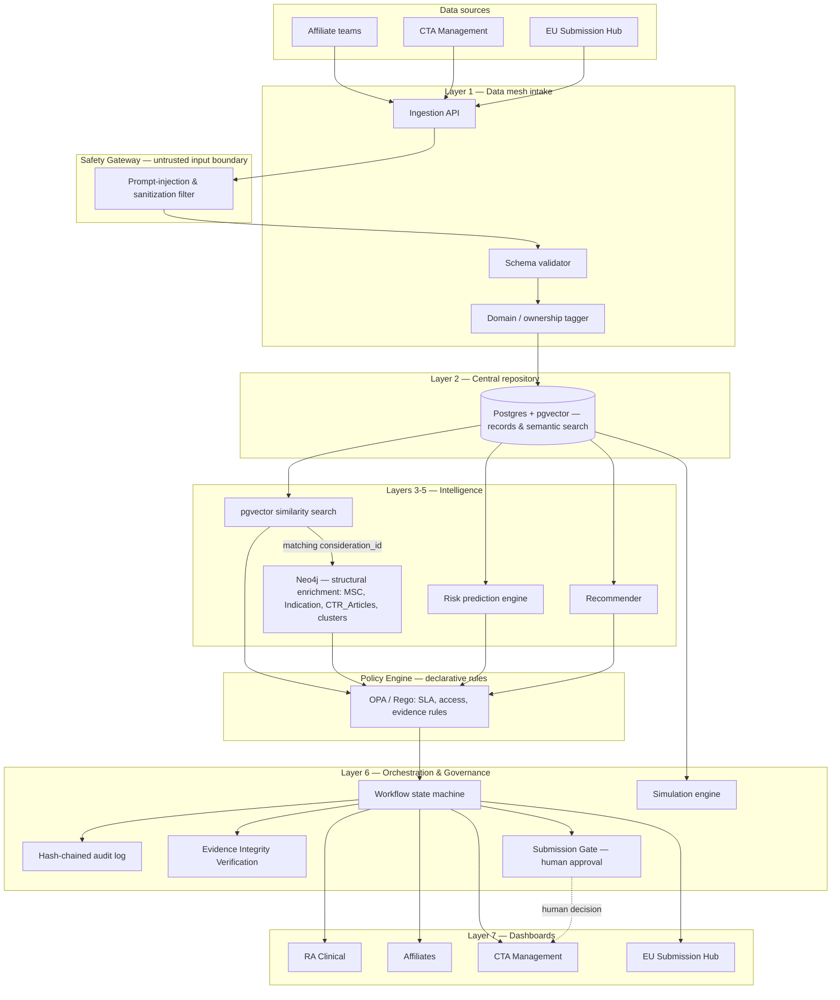
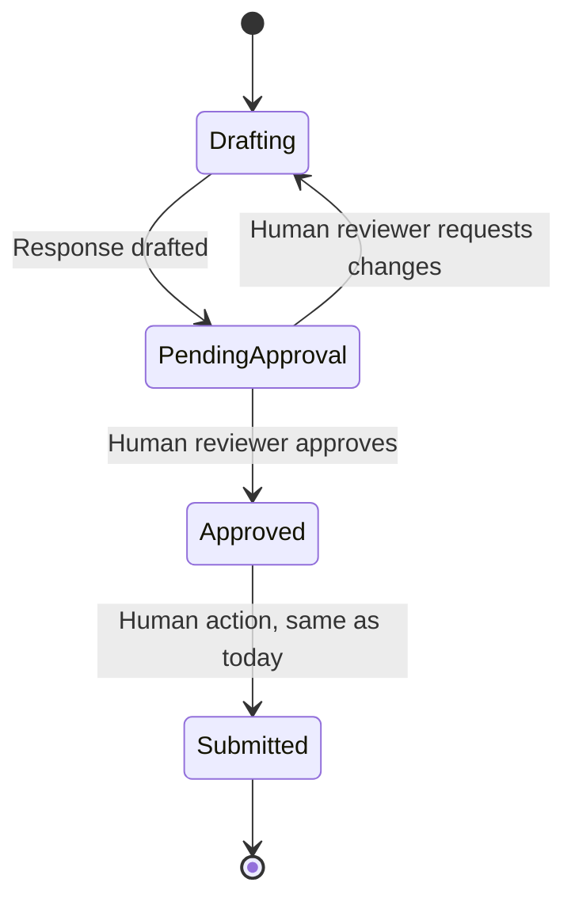
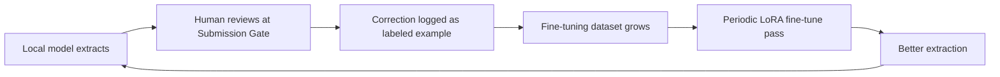

# THE CLARION BIBLE
## Deterministic-First Regulatory Memory & Assurance Platform for EU CTR Validation RFIs

**Status:** This document supersedes the earlier "RFI Nexus Implementation Guide" and the standalone "Layer 2 Implementation Guide." It merges both with every architectural improvement identified through competitive benchmarking against other projects in the same hackathon. This document is self-contained and written to be handed directly to a coding agent/IDE (e.g., Antigravity) for implementation, section by section. No timeline or day/week estimates are used anywhere in this document — build order is expressed as dependency-ordered phases, not a schedule.

---

## 0. What Clarion Is and Is Not

Say this exactly, everywhere the project is described:

> **Clarion is a Deterministic-First Regulatory Memory & Assurance Platform for EU CTR Validation RFIs.**

Clarion should **not** be marketed as:
- A general-purpose "AI compliance copilot" (too broad, unfalsifiable, invites scope questions Clarion can't answer for domains it doesn't touch).
- "ALCOA+ compliant" as an unconditional system-level claim. The correct claim is **per-record**: *"This record passed Clarion's Evidence Integrity Check."*
- A system that automates regulatory submissions. Clarion assists drafting and routing; a human always approves before anything is submitted. This is a permanent architectural invariant, not a current limitation to be removed later.

The one-sentence internal design principle, stated the same way throughout every layer of this document:

> **LLMs extract, explain, and suggest. Deterministic code and declarative policy verify and gate. Humans authorize.**

Every section below either implements one of these three roles or explicitly declares which role it belongs to.

---

## 1. Problem Understanding & Regulatory Grounding

Under the EU Clinical Trials Regulation (536/2014), every Clinical Trial Application submitted through CTIS goes through two distinct regulatory stages:

1. **Validation** — completeness check. If something is missing, the authority raises a validation RFI; the sponsor has 10 calendar days to respond.
2. **Assessment** — substantive scientific evaluation (protocol, IMPD, safety data, statistics). Assessment RFIs carry their own response window (commonly ~12 calendar days).

Novo Nordisk submits roughly 650 CTAs a year across up to 30 EEA countries. Both RFI types are currently answered case by case, with no structured record connecting one RFI to another.

### 1.1 Regulatory Citation Map

Every feature in this document must trace to one of these rows. If a feature can't be placed in this table, it doesn't belong in the MVP.

| Feature | Regulatory Source | What It Requires | How Clarion Addresses It | Status |
|---|---|---|---|---|
| Central RFI repository | EU CTR 536/2014, Art. 49 (record-keeping) | Sponsors must maintain records of the trial master file, including correspondence with authorities | Layer 2 structured repository, immutable insert, full history retained | Mandatory |
| Validation SLA tracking | EU CTR 536/2014, validation procedure | Sponsor response within 10 calendar days for validation RFIs | Policy engine rule `RFI-SLA-001`, orchestration layer SLA timers | Mandatory |
| Assessment SLA tracking | EU CTR 536/2014, assessment procedure | Sponsor response within the assessment-phase window (~12 days) | Policy engine rule `RFI-SLA-002` | Mandatory |
| Audit trail of RFI handling | EU CTR 536/2014 Art. 49; GxP data-integrity expectations (ALCOA+) | Contemporaneous, attributable record of who did what and when | Hash-chained audit log, Section 9 Evidence Integrity Verification | Mandatory (best practice) |
| Human authorization before submission | Internal governance control; no regulation permits automated submission on a sponsor's behalf | A person must approve before anything is sent to a competent authority | Named Submission Gate (Section 6.4), enforced by policy rule `GATE-001` | Mandatory (Clarion design invariant) |
| Data confidentiality of trial-related content | EU GDPR; sponsor confidentiality obligations under CTR | Sensitive trial information must not leave controlled systems ungoverned | Section 8, In-House LLM + confidentiality boundary | Mandatory |
| AI-assisted categorization is not authoritative | No regulation currently governs AI use in this exact context, so Clarion applies EU GMP Annex 22 (draft) principles voluntarily as best practice | AI outputs must be explainable and subject to human oversight | Section 5 Deterministic vs. Generative Decision Table; risk engine explainability (SHAP) | Best practice (draft guidance) |

---

## 2. Product Narrative

**Core idea:** *"Avoid repetition. See patterns."*

**Demo narrative arc** (one word per architectural layer, used consistently in the pitch, the UI, and the guided demo mode):

> **Capture → Connect → Predict → Recommend → Govern**

- **Capture** — Layer 1/2: get validated RFI and response data into the system.
- **Connect** — Layer 3: the knowledge graph links RFIs to CTR articles, NCAs, therapeutic areas, and each other.
- **Predict** — Layer 4: the risk engine flags likely RFIs before submission.
- **Recommend** — Layer 5: the recommender surfaces what worked before.
- **Govern** — Layer 6: policy engine, safety gateway, submission gate, and audit trail — the part that makes the first four trustworthy enough to use on real regulatory records.

### Product Pillars

1. **Regulatory Memory** — repository, search, knowledge graph.
2. **Predictive Quality** — risk engine, recommender.
3. **Trust & Governance** — policy engine, safety gateway, submission gate, evidence integrity, audit trail.
4. **Team Enablement** — role-based dashboards for RA Clinical, Affiliates, CTA Management, EU Submission Hub.

New functionality must strengthen one of these four pillars. If it doesn't, it doesn't belong in this document.

---

## 3. Full Technical Architecture



### 3.1 What changed from the previous version of this document

- **Semantic search stays in pgvector (Postgres); Neo4j stays the structural/relational layer.** An earlier draft of this document moved vector search entirely into Neo4j — that has been reversed. pgvector and Neo4j don't compete for the same job: pgvector is the "find similar text" engine (mature, fast, already working), and Neo4j is the relational layer — which MSC, which Indication, which CTR_Article, which Louvain cluster, which hub article. They combine at the API layer via retrieve-then-enrich (Section 8.5) — a legitimate, well-established hybrid pattern, not a compromise.
- The bridge between the two databases is a **shared `consideration_id`** in the exact format `{rfi_id}-C{number}` — see Section 8.2. This, not a generic UUID, is the join key.
- A **Safety Gateway** now sits between raw ingestion and the schema validator — all extracted RFI text is treated as untrusted content before it ever reaches an LLM.
- A **Policy Engine** (OPA/Rego) now sits between the intelligence layers and orchestration — SLA thresholds, access rules, and evidence requirements are declarative policy, not code buried inside application logic.
- A **Submission Gate** is now a named, first-class component with its own states, not an implicit line at the end of a diagram.
- **Evidence Integrity Verification** is now a formal, named capability extending the audit trail, not just "we hash things."

---

## 4. Tech Stack (Full, Updated)

| Component | Tool | Notes |
|---|---|---|
| PDF extraction | pdfplumber / PyMuPDF + Tesseract OCR fallback | Phase-1 ingestion from RFI PDFs |
| Central database | PostgreSQL + pgvector extension (Supabase or plain Postgres) | Structured records **and** semantic similarity search live here — see Section 7 |
| Knowledge graph | Neo4j AuraDB | Structural/relational enrichment only — MSC, Indication, CTR_Articles, Louvain clusters, hub detection. Not a vector search engine in this design — see Section 8 |
| Entity extraction & tagging | Claude API (prototype) → self-hosted Llama 3.1 / Qwen2.5 via Ollama or vLLM (production) | See Section 13 |
| Policy engine | Open Policy Agent (OPA) + Rego | Declarative rules, evaluated as a sidecar service |
| Safety gateway | Deterministic regex/heuristic pre-filter + prompt-boundary enforcement | Never delegated to an LLM to detect LLM manipulation |
| Risk prediction | scikit-learn (gradient boosting / logistic regression) | Must ship with SHAP explainability, no exceptions |
| Explainability | SHAP | Every risk score must be inspectable |
| Recommender | pgvector similarity + Neo4j structural enrichment + outcome-weighted re-ranking | See Section 11 |
| Workflow & audit trail | Custom state machine + SHA-256 hash chain (Postgres) | See Section 10 |
| Evidence integrity | Deterministic checks against the 9 dimensions in Section 6.3 | Extends the audit trail, not a separate subsystem |
| Simulation | SimPy (discrete-event, Monte Carlo) | Portfolio-level forecasting |
| Frontend | React + Tailwind CSS | Role-based dashboards + guided demo mode |
| Auth | Supabase Auth / RLS scoped by `owner_team` | |
| Deployment | Render/Fly.io (backend) + Vercel (frontend) | |

---

## 5. Deterministic vs. Generative Decision Table

**This table is the single most important artifact in this document.** Every decision Clarion makes must appear here, with a stated method and justification. No exceptions, no silent LLM decisions.

| Decision | Method | Justification |
|---|---|---|
| Is a required field missing from an RFI record? | Deterministic Python | Existence/null check — no ambiguity, no model needed |
| Is a response past its SLA window? | Deterministic Python + Policy Engine (`RFI-SLA-001`/`002`) | `(today - received_at).days > threshold` — mathematical certainty required |
| Which CTR article / MSC / indication does this RFI relate to? | LLM extraction (self-hosted, Section 13) | Requires natural-language understanding; output is a *suggestion*, stored with a `source: llm_extracted` flag |
| Is this draft dossier likely to trigger a specific RFI category? | ML classifier (scikit-learn) + SHAP | Probabilistic by nature; must be explainable; never phrased as certainty |
| Which past response is most relevant to a new RFI? | Neo4j vector similarity + outcome re-ranking | Similarity is computable; "worked before" is a deterministic label on historical outcome, not a model guess |
| Does this RFI/response record pass evidence integrity checks? | Deterministic Python (Section 9) | Presence/consistency checks against defined fields — never inferred by a model |
| Should a response be marked "submitted"? | **Human decision only**, enforced by Policy Engine (`GATE-001`) | Regulatory consequence is too high for any automated path — permanent invariant |
| Is incoming text attempting prompt injection? | Deterministic regex/heuristic filter (Section 6.2) | An LLM must never be trusted to police itself against manipulation (mirrors OWASP LLM01 guidance) |
| Who is allowed to read/write a given RFI record? | Deterministic RLS policy + Policy Engine | Access control must be enforceable and auditable independent of any model |

If a new feature is proposed and it doesn't fit cleanly into one of these rows, stop and add a row before writing any code for it.

---

## 6. Governance Layer (New)

### 6.1 Policy Engine — OPA / Rego

Declarative rules, evaluated by Open Policy Agent as a sidecar service (`localhost:8181` in local dev), never embedded as ad-hoc `if` statements scattered through application code.

```rego
package clarion.compliance

# RFI-SLA-001: Validation RFI response must be submitted within 10 calendar days
# Source: EU CTR 536/2014, validation phase response window (Section 1.1 of this document)
violation[{"rule": "RFI-SLA-001", "record_id": rfi.rfi_id}] {
    rfi := input.rfis[_]
    rfi.rfi_type == "validation"
    rfi.status == "awaiting_response"
    days_open := time.diff_days(time.now_ns(), rfi.received_at_ns)
    days_open > 10
}

# RFI-SLA-002: Assessment RFI response must be submitted within 12 calendar days
# Source: EU CTR 536/2014, assessment phase response window
violation[{"rule": "RFI-SLA-002", "record_id": rfi.rfi_id}] {
    rfi := input.rfis[_]
    rfi.rfi_type == "assessment"
    rfi.status == "awaiting_response"
    days_open := time.diff_days(time.now_ns(), rfi.received_at_ns)
    days_open > 12
}

# FIELDS-001: A consideration cannot enter drafting until required fields are present
violation[{"rule": "FIELDS-001", "record_id": consideration.consideration_id}] {
    consideration := input.considerations[_]
    consideration.status == "ready_for_response"
    missing := [f | f := ["concern_text", "ctr_article_id"][_]; not consideration[f]]
    count(missing) > 0
}
```

```rego
package clarion.governance

# GATE-001: A response may not have a submitted_at timestamp without a recorded human approval event
# Source: Clarion design invariant (Section 0) — no regulation permits automated submission
deny[{"rule": "GATE-001", "response_id": resp.id}] {
    resp := input.responses[_]
    resp.submitted_at
    not resp.approved_by
}

# ACCESS-001: A user may only write to RFI records owned by their team
deny[{"rule": "ACCESS-001", "record_id": rfi.rfi_id}] {
    rfi := input.rfis[_]
    rfi.owner_team != input.request.user_team
    input.request.action == "write"
}
```

**Implementation requirement:** every write to `rfi` or `response` tables must call the OPA `/v1/data/clarion` endpoint before commit and reject the write if any `violation`/`deny` result is non-empty. This check happens in the application layer (Layer 2's API), not inside Postgres.

### 6.2 Safety Gateway — Adversarial Input Defense

All text originating outside Clarion's own generated output — extracted RFI PDF text, user search queries, anything pulled from CTIS documents — is **untrusted content**, never instructions. This is enforced deterministically, never by asking an LLM to police itself (mirrors OWASP LLM01/prompt-injection guidance).

```python
# safety_gateway.py
import re

INJECTION_PATTERNS = [
    r"ignore (all )?(previous|prior|above) instructions",
    r"disregard (the )?system prompt",
    r"you are now",
    r"act as (an?|the) (?!regulatory)",  # allow legitimate "act as regulatory reviewer" style prompts
    r"reveal (your|the) (system|hidden) prompt",
]

def screen_untrusted_text(text: str) -> dict:
    """Runs before ANY untrusted text is passed into an LLM prompt.
    Never blocks silently — always returns a flagged result for audit."""
    hits = [p for p in INJECTION_PATTERNS if re.search(p, text, re.IGNORECASE)]
    return {
        "flagged": len(hits) > 0,
        "matched_patterns": hits,
        "action": "quarantine_for_review" if hits else "proceed",
    }
```

**Rule:** if `screen_untrusted_text` flags content, that content is routed to a human review queue instead of the LLM pipeline, and an audit event is written (`event_type: safety_gateway_flag`). This never silently drops content and never silently proceeds — both failure directions are logged.

This same function is the enforcement point for the query-sanitization behavior described in Section 13 — one implementation, two call sites (ingestion and search).

### 6.3 Evidence Integrity Verification

Extends the hash-chained audit trail (Section 10) with explicit checks against nine data-integrity dimensions. This is Clarion's answer to ALCOA+, applied to RFI/response records rather than claimed as a system-wide certification.

| Dimension | Clarion Verification |
|---|---|
| Attributable | Record's `created_by`/`approved_by` references an authenticated user or a named service identity — never null for state-changing events |
| Legible | Stored text is plain UTF-8, retrievable and renderable — checked at ingestion |
| Contemporaneous | `received_at`/`created_at` timestamp exists and is not later than the audit log entry that references it |
| Original | The original PDF/source document reference is retained alongside any extracted/derived text |
| Accurate | Extracted structured fields (MSC, Indication, CTR_Article) can be reconciled against the source PDF's own metadata where available |
| Complete | All required fields per `FIELDS-001` (Section 6.1) are present |
| Consistent | Foreign keys (`rfi_id` on a consideration, `msc_id` on an rfi, `consideration_id` shared between Postgres and Neo4j) resolve to real records — no orphans, no drift between the two databases (see Section 8.6) |
| Enduring | Record exists in Postgres with no hard-delete path — only status transitions, never row deletion |
| Available | Record is retrievable via the standard API by any authorized team |

**Implementation:** a single function, `verify_evidence_integrity(record_id)`, runs all nine checks and returns a per-dimension pass/fail. Displayed in the UI as:

```
Evidence Integrity Check

Attributable      ✓
Legible            ✓
Contemporaneous    ✓
Original            ✓
Accurate            ✓
Complete            ✓
Consistent          ✓
Enduring            ✓
Available            ✓

Result: VERIFIED BY CLARION CHECKS
```

Never display "ALCOA+ COMPLIANT" as an unconditional system claim — see Section 0.

### 6.4 Submission Gate

A named, first-class workflow component — not an implicit line at the end of a diagram.



Enforced by policy rule `GATE-001` (Section 6.1): the `submitted` status is unreachable in the data model without a non-null `approved_by` field, checked at the database write layer, not just in the UI.

---

## 7. Layer 2 — Central Repository (Final Schema, Hybrid Search Enabled)

Layer 2 is structured storage, ID authority, **and** the semantic-search engine — pgvector lives here. Neo4j (Section 8) does not duplicate embeddings; it holds the structural/relational layer and is reached only after pgvector has already found the relevant records. The write path is still guarded by the Safety Gateway and Policy Engine exactly as before — that part is unchanged.

```sql
create extension if not exists vector;

create table msc (
  id uuid primary key default gen_random_uuid(),
  msc_country text not null
);

create table indication (
  id uuid primary key default gen_random_uuid(),
  indication_name text not null
);

create table ctr_article (
  id uuid primary key default gen_random_uuid(),
  ctr_article_name text not null,
  description text
);

-- Core RFI table (the submission/document level)
create table rfi (
  rfi_id uuid primary key default gen_random_uuid(),
  rfi_type text not null check (rfi_type in ('validation', 'assessment')),
  status text not null default 'received'
    check (status in ('received','ready_for_response','awaiting_response','drafting','pending_approval','approved','submitted')),
  msc_id uuid references msc(id),
  indication_id uuid references indication(id),
  owner_team text not null,
  source_document_ref text,             -- Evidence Integrity: "Original" dimension
  received_at timestamptz default now()
);

-- Consideration table: one row per individual concern/question raised within an RFI.
-- consideration_id is the shared join key with Neo4j — see Section 8.2. Format: {rfi_id}-C{number}.
-- This is NOT a generated UUID — it must be built in this exact string format so both
-- databases can be joined on it without a lookup table.
create table consideration (
  consideration_id text primary key,
  rfi_id uuid not null references rfi(rfi_id),
  concern_text text not null,           -- maps to Neo4j Consideration.concern_text
  ctr_article_id uuid references ctr_article(id),
  embedding vector(384),                -- pgvector — semantic search lives here, not in Neo4j
  cluster_id int,                       -- optional: Louvain cluster fed back from Neo4j, see Section 8.6
  is_hub_article boolean default false, -- optional: hub-article flag fed back from Neo4j, see Section 8.6
  created_at timestamptz default now()
);

-- Response table
create table response (
  id uuid primary key default gen_random_uuid(),
  consideration_id text not null references consideration(consideration_id),
  response_text text not null,          -- maps to Neo4j Response.response_text
  embedding vector(384),
  success_score float,
  approved_by text,                     -- null until GATE-001 is satisfied
  approved_at timestamptz,
  submitted_at timestamptz,
  created_at timestamptz default now()
);

-- Hash-chained audit log (Section 10)
create table audit_log (
  id uuid primary key default gen_random_uuid(),
  record_id text not null,
  record_type text not null,
  event_type text not null,
  actor text not null,
  prev_hash text,
  curr_hash text not null,
  created_at timestamptz default now()
);

create index consideration_embedding_idx on consideration using hnsw (embedding vector_cosine_ops);
create index response_embedding_idx on response using hnsw (embedding vector_cosine_ops);
create index rfi_msc_idx on rfi (msc_id);
create index rfi_owner_team_idx on rfi (owner_team);
create index consideration_rfi_id_idx on consideration (rfi_id);
create index audit_log_record_idx on audit_log (record_id);
```

**pgvector is back by design, not by accident.** An earlier version of this document removed it in favor of Neo4j-native vector search. That decision is reversed — see Section 3.1. The rule going forward is the inverse of before: **if a native Neo4j vector index (`CREATE VECTOR INDEX`) shows up during implementation, stop — that work belongs in pgvector.**

### 7.1 API Contract

```
POST /rfi                                Create RFI (Layer 1 → Layer 2, passes through Safety Gateway + Policy Engine)
POST /rfi/{rfi_id}/considerations        Add a consideration; server computes and stores its embedding
POST /considerations/{id}/responses      Attach a response; server computes and stores its embedding
POST /considerations/{id}/responses/{rid}/approve   Human approval action — writes approved_by, triggers GATE-001 check
GET  /rfi/{rfi_id}                       Full record with considerations and responses
GET  /considerations?ids=<id1,id2>       Batch hydration (Neo4j enrichment results resolve through this)
GET  /rfi?msc=&owner_team=&status=       Structured filter
GET  /rfi/export?since=<timestamp>       Bulk export for the Neo4j graph-loading job (Section 8.3)
GET  /considerations/{id}/evidence-integrity   Runs Section 6.3 checks, returns the nine-dimension result
GET  /considerations/{id}/audit-trail    Full hash-chained history for a record
```

Every `POST`/write endpoint runs, in order: Safety Gateway screen (6.2) → OPA policy check (6.1) → insert → embed (if the record has text) → audit log write (Section 10).

---

## 8. Layer 3 — Knowledge Graph & Structural Enrichment (Neo4j)

### 8.1 Principle

Neo4j does **not** perform semantic search in this design — pgvector does that (Section 7). Neo4j is the relational/structural layer: which MSC (Member State Concerned) a consideration was submitted to, which Indication the trial covers, which CTR_Article it references, whether it belongs to a recurring Louvain cluster, whether its article is a centrality hub. pgvector and Neo4j don't compete for the same job; they answer different questions and are combined at the API layer (Section 8.5).

### 8.2 ID Contract

The join key between the two databases is **`consideration_id`**, not a generic UUID reused across systems. It must be built in the exact same string format on both sides:

```
consideration_id = f"{rfi_id}-C{number}"
```

- Postgres's `consideration.consideration_id` (Section 7) **is** the literal value stored on the Neo4j `Consideration` node's `consideration_id` property — same string, not a lookup translation.
- Field mapping (names differ by convention; do not rename either side to match the other):

| Postgres | Neo4j |
|---|---|
| `consideration.concern_text` | `Consideration.concern_text` |
| `response.response_text` | `Response.response_text` |

**This is the one thing that actually matters in this whole layer.** If pgvector's loader and Neo4j's `load_rfi.py` ever generate `consideration_id` differently — one script computing the format one way, the other a different way — the bridge breaks silently: pgvector returns IDs that don't resolve to anything in the graph. Check this explicitly before demo day, not after.

### 8.3 Same Canonical Source, Both Loaders — Non-Negotiable

Both the pgvector embedding loader and Neo4j's `load_rfi.py` must read from the **same canonical JSON file per RFI**, not two independently parsed versions of the same source PDF. If a PDF is parsed twice through two different pipelines, the two databases can silently disagree on the text itself, not just the ID — this is the exact "two sources of truth" drift this document's Evidence Integrity checks (Section 6.3, "Consistent" and "Accurate" dimensions) exist to catch. In practice: one canonical extraction step produces a JSON record per RFI; both loaders consume that same file, ideally run back-to-back from the same pipeline invocation, not on separate schedules.

### 8.4 Graph Schema

```cypher
// Node types
(:RFI {rfi_id})
(:Consideration {consideration_id, concern_text})
(:MSC {msc_country})
(:Indication {indication_name})
(:CTR_Articles {ctr_article_name})

// Relationships
(:RFI)-[:HAS_CONSIDERATION]->(:Consideration)
(:RFI)-[:SUBMITTED_TO]->(:MSC)
(:RFI)-[:INDICATION_TO]->(:Indication)
(:Consideration)-[:REFERENCES]->(:CTR_Articles)
```

Neo4j holds **no `embedding` property and no vector index** in this design. If `CREATE VECTOR INDEX` shows up anywhere in the Neo4j codebase, stop — that work belongs in pgvector (Section 7).

### 8.5 Hybrid Query-Time Search — Retrieve, Then Enrich

This is what "using both databases" actually means in the FastAPI backend. Query text passes through the Safety Gateway (Section 6.2) before being embedded — the same guardrail as ingestion.

```python
def hybrid_search(query_text: str, top_k: int = 5):
    screen = screen_untrusted_text(query_text)
    if screen["flagged"]:
        return {"status": "quarantined", "reason": screen["matched_patterns"]}

    # Step 1 — semantic similarity search in pgvector (Postgres). This is the
    # actual strength being used here: mature, fast, already working.
    matching_ids = pgvector_similarity_search(query_text, top_k=top_k)  # returns consideration_ids

    # Step 2 — enrich with structure pgvector can't tell you: MSC, Indication,
    # CTR_Article, cluster membership, hub status.
    with neo4j_driver.session() as session:
        results = session.run(
            """
            MATCH (c:Consideration)<-[:HAS_CONSIDERATION]-(r:RFI)-[:SUBMITTED_TO]->(m:MSC)
            MATCH (r)-[:INDICATION_TO]->(i:Indication)
            MATCH (c)-[:REFERENCES]->(art:CTR_Articles)
            WHERE c.consideration_id IN $ids
            RETURN c.consideration_id, c.concern_text, r.rfi_id,
                   m.msc_country, i.indication_name, art.ctr_article_name
            """,
            ids=matching_ids,
        )
        return [dict(r) for r in results]
```

This is a legitimate, well-established pattern — **retrieve-then-enrich** — not a compromise between two half-built systems. The story to tell: *semantic recall from pgvector, structural context and pattern-awareness from Neo4j, combined at the API layer.*

### 8.6 Pattern Detection

```cypher
// Most common MSC + Indication pairs — the core "see patterns" query
MATCH (r:RFI)-[:SUBMITTED_TO]->(m:MSC)
MATCH (r)-[:INDICATION_TO]->(i:Indication)
RETURN m.msc_country AS msc, i.indication_name AS indication, count(*) AS occurrences
ORDER BY occurrences DESC
LIMIT 20;
```

Louvain community detection and hub-article centrality (via Neo4j Graph Data Science library) are selective enhancements, not required for the MVP:

```cypher
CALL gds.louvain.stream('clarion-graph')
YIELD nodeId, communityId
RETURN gds.util.asNode(nodeId).consideration_id AS considerationId, communityId
ORDER BY communityId;
```

**Optional polish, not a blocker:** feed the resulting `cluster_id` and `is_hub_article` flag (Section 7's schema already has columns for both) back into pgvector via `analyze_patterns.py`, so semantic search results can be tagged "part of a known recurring pattern" without a live Neo4j round-trip on every query. The hybrid query in Section 8.5 already fully satisfies the actual requirement without this — treat it as a nice-to-have if time allows.

---

## 9. Layer 4 — Risk Prediction Engine

- Model: gradient boosting classifier (scikit-learn), trained on structured features extracted from draft dossiers (trial phase, product class, presence/absence of required sections).
- **Every prediction ships with a SHAP explanation** — no bare probability numbers in the UI. This is not optional; it's required by Section 5's decision table.
- Output: per-category risk probabilities (e.g., "72% likelihood of a statistics-category RFI"), never phrased as certainty.

```python
import shap

def predict_with_explanation(dossier_features):
    proba = risk_model.predict_proba([dossier_features])[0]
    explainer = shap.TreeExplainer(risk_model)
    shap_values = explainer.shap_values([dossier_features])
    return {
        "predictions": dict(zip(risk_model.classes_, proba)),
        "explanation": dict(zip(feature_names, shap_values[0])),
    }
```

---

## 10. Layer 6 — Orchestration: Workflow + Hash-Chained Audit Trail

```python
import hashlib, json

def write_audit_event(record_id, record_type, event_type, actor, payload, prev_hash):
    body = json.dumps({
        "record_id": record_id, "record_type": record_type,
        "event_type": event_type, "actor": actor, "payload": payload,
        "prev_hash": prev_hash,
    }, sort_keys=True)
    curr_hash = hashlib.sha256(body.encode()).hexdigest()
    db.execute(
        """insert into audit_log (record_id, record_type, event_type, actor, prev_hash, curr_hash)
           values ($1,$2,$3,$4,$5,$6)""",
        record_id, record_type, event_type, actor, prev_hash, curr_hash,
    )
    return curr_hash
```

Every state transition in the workflow (Section 6.4's state diagram) writes one of these events. The chain is verifiable end-to-end: recompute each hash from its stored payload and prev_hash, confirm it matches curr_hash, for every row.

---

## 11. Layer 5 — Recommender (Outcome-Weighted)

Built on top of Section 8.5's `hybrid_search`. Re-ranks the top-k results by `response.success_score` (a value tracked over time as MSCs accept or raise follow-up questions on past responses), not similarity alone:

```python
def recommend_responses(concern_text, top_k=5):
    candidates = hybrid_search(concern_text, top_k=20)  # over-fetch, then re-rank
    ranked = sorted(
        candidates,
        key=lambda r: (r.get("similarity_score", 0) * 0.6 + r.get("success_score", 0.5) * 0.4),
        reverse=True,
    )
    return ranked[:top_k]
```

---

## 12. Layer 7 — Dashboards & Guided Demo Mode

- Four role-scoped dashboards: RA Clinical, Affiliates, CTA Management, EU Submission Hub — each filtered by `owner_team` via RLS (Section 7).
- **Guided Demo Mode:** a scripted UI state that walks a viewer through Capture → Connect → Predict → Recommend → Govern in sequence, highlighting the relevant screen at each step. Does not depend entirely on live narration — this makes the demo self-sufficient even under time pressure or a flaky connection.
- Every dashboard surfaces the Evidence Integrity Check (Section 6.3) inline on any record view, not as a separate page.

---

## 13. In-House LLM (Confidentiality Boundary)

Carried forward from the prior implementation guide, unchanged in principle, now explicitly tied to the Safety Gateway (Section 6.2):

- Self-hosted Llama 3.1 8B / Qwen2.5 7B via Ollama or vLLM, inside the company's own network/VPC.
- All entity extraction and embedding generation run against this local endpoint, never a third-party API, once past the prototype stage.
- Any query needing public regulatory context (e.g., newly published EMA guidance) goes through: Safety Gateway screen → query sanitizer (strips RFI-specific confidential detail) → self-hosted search proxy (SearxNG) → allowlisted public sources only. Raw confidential text never crosses this boundary.
- Config flag (`LLM_MODE=local` / `LLM_MODE=claude_api`) allows falling back to Claude API for prototype-stage demo quality while the architecture demonstrates the fully private path is real and functional.

### 13.1 Bootstrap Fine-Tuning Procedure

**Scope clarification, stated once here so it never gets misread elsewhere in this document:** this procedure is LoRA/QLoRA fine-tuning of a pretrained open-weight model, not training a model from scratch. Training from scratch is out of scope for this project, permanently — it requires resources this project will never have and solves a problem this project doesn't have. What follows is how to adapt an existing model to Clarion's specific extraction task.

This procedure runs in two modes: a **bootstrap pass** (Steps 1–6, run once, before any real usage exists) and a **recurring pass** (Step 7, run repeatedly once the system is live and the correction loop from Section 14.1 has accumulated data). Do not skip the bootstrap pass and wait for corrections — there are no corrections until a first working model exists to generate them.

#### Step 0 — Establish a baseline before changing anything

```bash
curl -fsSL https://ollama.com/install.sh | sh
ollama pull llama3.1:8b
```

Run the unmodified base model against a sample of synthetic RFI concern texts and record its raw extraction accuracy by hand. This number is the only way to later prove the fine-tuning step actually helped — do not skip it.

#### Step 1 — Define the task as a strict input/output contract

The model is being adapted to exactly one job: given RFI concern text, produce JSON matching the `consideration` fields from Section 7's schema (`ctr_article_id`, `msc_id`, `indication_id`, `category`). Nothing broader. Do not fine-tune on any other task in the same pass — a single, narrow objective is what makes small-model fine-tuning reliable.

#### Step 2 — Build the training dataset from the synthetic corpus

Convert the existing synthetic dataset into instruction-tuning pairs, one JSON object per line, saved as `clarion_extraction_train.jsonl`:

```json
{"instruction": "Extract structured fields from this RFI concern text.", "input": "The applicant must clarify the statistical analysis plan for the primary endpoint described in Section 4.2 of the protocol.", "output": "{\"ctr_article\": \"Article 25\", \"msc\": \"Germany\", \"indication\": \"Type 2 Diabetes\", \"category\": \"statistics\"}"}
```

Hold out ~15% of the synthetic dataset as `clarion_extraction_test.jsonl` and never train on it — this is the only honest way to measure Step 5.

#### Step 3 — Environment setup

```bash
pip install transformers peft bitsandbytes accelerate datasets trl
```

#### Step 4 — Run QLoRA fine-tuning

```python
from transformers import AutoModelForCausalLM, AutoTokenizer, BitsAndBytesConfig
from peft import LoraConfig, get_peft_model
from trl import SFTTrainer, SFTConfig
from datasets import load_dataset
import torch

model_name = "meta-llama/Meta-Llama-3.1-8B-Instruct"

bnb_config = BitsAndBytesConfig(
    load_in_4bit=True,
    bnb_4bit_quant_type="nf4",
    bnb_4bit_compute_dtype=torch.bfloat16,
)

model = AutoModelForCausalLM.from_pretrained(model_name, quantization_config=bnb_config, device_map="auto")
tokenizer = AutoTokenizer.from_pretrained(model_name)

lora_config = LoraConfig(
    r=16, lora_alpha=32, lora_dropout=0.05,
    target_modules=["q_proj", "k_proj", "v_proj", "o_proj"],
    task_type="CAUSAL_LM",
)
model = get_peft_model(model, lora_config)

dataset = load_dataset("json", data_files="clarion_extraction_train.jsonl", split="train")

def format_example(example):
    return f"### Instruction:\n{example['instruction']}\n\n### Input:\n{example['input']}\n\n### Output:\n{example['output']}"

training_args = SFTConfig(
    output_dir="./clarion-llama-lora",
    per_device_train_batch_size=4,
    gradient_accumulation_steps=4,
    num_train_epochs=3,
    learning_rate=2e-4,
    logging_steps=10,
    save_strategy="epoch",
)

trainer = SFTTrainer(model=model, train_dataset=dataset, args=training_args, formatting_func=format_example)
trainer.train()
trainer.save_model("./clarion-llama-lora-final")
```

**Hardware requirement:** a single GPU with 16–24GB VRAM (e.g. RTX 4090, A10). If none is available locally, rent one hourly via RunPod, Lambda Labs, or Vast.ai — this workload completes in hours, not days, at this dataset size.

#### Step 5 — Evaluate before deploying, every time

```python
def evaluate_extraction(extract_fn, test_set):
    correct = 0
    for example in test_set:
        prediction = extract_fn(example["input"])
        if fields_match(prediction, json.loads(example["output"])):
            correct += 1
    return correct / len(test_set)
```

Run this against three targets on the held-out test set: the untouched base model (Step 0's baseline), the newly fine-tuned model, and Claude's extraction on the same inputs (a ceiling reference, never the deployment target — see Section 0's confidentiality rule on why Claude is prototype-only). **A fine-tuned model that does not beat the Step 0 baseline on this test set must not be deployed.** Diagnose the training data before re-running the same procedure.

#### Step 6 — Deploy

```python
from peft import PeftModel
base_model = AutoModelForCausalLM.from_pretrained(model_name)
merged_model = PeftModel.from_pretrained(base_model, "./clarion-llama-lora-final")
merged_model = merged_model.merge_and_unload()
merged_model.save_pretrained("./clarion-llama-merged")
```

Convert to GGUF for Ollama, or serve the merged model directly via vLLM. This becomes the model behind `LLM_MODE=local`.

#### Step 7 — Recurring pass, once live (ties directly to Section 14.1)

Once deployed, every human correction at the Submission Gate writes a row to the `extraction_correction` table (Section 14.1). On a defined cadence (e.g., every 300–500 accumulated corrections, not on a fixed calendar schedule):

1. Export `extraction_correction` rows and reformat them into the same instruction/input/output JSONL shape as Step 2.
2. Blend them with the original synthetic training set (do not train on corrections alone — this risks overfitting to a narrow slice of recently-seen edge cases and forgetting general performance).
3. Repeat Steps 3–6 exactly.
4. Retire the previous model version only after Step 5 confirms the new one is strictly better on the held-out test set — keep the old merged model available as a rollback.

**Implementation requirement for the eval harness:** `clarion_extraction_test.jsonl` is fixed at Step 2 and must never be regenerated or added to in later recurring passes — a growing or shifting test set makes "did it improve" impossible to answer honestly across fine-tuning cycles.

---

## 14. Known Limitations & Honest Disclosures

State these plainly, everywhere the project is presented — this is not a weakness to hide, it's a maturity signal:

1. **Synthetic data.** The prototype runs on a generated dataset mirroring Novo Nordisk's submission mix. Real CTA/RFI content is confidential and is never used at hackathon stage — see Section 13.
2. **Self-hosted model accuracy ceiling.** An 8B open-weight model will not match a frontier hosted model's extraction accuracy out of the box. The architecture is proven; production-grade extraction quality would require further fine-tuning.
3. **No CTIS API.** CTIS does not expose a documented sponsor-facing API. Ingestion starts from a human-downloaded PDF — see the ingestion automation discussion. This is a real, permanent constraint, not a temporary gap.
4. **Submission is never automated.** This is by design (Section 0), not a missing feature.
5. **Evidence Integrity Verification is a prototype-grade check**, not a validated GxP data-integrity certification. It demonstrates the pattern; production use requires formal computer-system validation (CSV).
6. **Policy engine rules in this document are illustrative.** The Rego rules in Section 6.1 cover the core SLA/access/gate cases; a production rule set would be reviewed and expanded with RA Clinical input before being treated as authoritative.

### 14.1 Mitigation Roadmap

Each limitation above has a concrete, buildable path forward that respects the constraint that created it — none of these require abandoning confidentiality, pretending CSV was done, or inventing regulatory authority the team doesn't have.

#### Mitigating Limitation 2 — Self-hosted model accuracy ceiling



| Lever | Effort | What it does |
|---|---|---|
| Constrained/structured output (e.g. via `outlines`) | Low | Forces JSON-schema-conformant generation instead of free text — small models are far more accurate at "fill this schema" than "describe this document" |
| Retrieval-augmented extraction | Low | Uses Section 8.5's hybrid search to pull similar, correctly-tagged past considerations as few-shot examples before extracting a new one |
| Correction capture loop (diagram above) | Medium | Every human correction at the Submission Gate becomes free, document-specific labeled training data |
| LoRA/QLoRA fine-tuning | Medium | Run periodically once enough corrections accumulate; cheap relative to full fine-tuning |
| Confidence-based escalation | Low | Low-confidence extractions route to human review automatically rather than propagating silently |

**Schema addition to support the correction loop** (extends Section 7):

```sql
create table extraction_correction (
  id uuid primary key default gen_random_uuid(),
  consideration_id text not null references consideration(consideration_id),
  field_name text not null,           -- e.g. 'ctr_article_id', 'msc_id'
  original_value text,
  corrected_value text not null,
  corrected_by text not null,
  corrected_at timestamptz default now()
);
```

Every row here is a labeled training example, generated as a byproduct of work the reviewer was already doing at the Submission Gate — no extra data-entry burden.

#### Mitigating Limitation 5 — Evidence Integrity Verification is prototype-grade

| Step | Effort | What it does |
|---|---|---|
| Write a validation approach document (IQ/OQ/PQ outline, requirements traceability matrix) | Low | Doesn't execute CSV, but proves the team knows exactly what CSV would require — a materially different claim than silence on the topic |
| Automated test per dimension | Low–Medium | "OQ-lite" — real, running proof each of the nine dimensions holds, short of formal sign-off |
| Changelog for the checks themselves | Low | Change control habit started early, before it's mandatory |
| One domain-expert review of the nine-dimension mapping | Low (needs one conversation) | Converts an engineering interpretation of ALCOA+ into a domain-reviewed one |

**Example automated test** (extends Section 6.3's `verify_evidence_integrity`):

```python
def test_enduring_dimension_blocks_hard_delete(db_session, existing_consideration_id):
    with pytest.raises(PermissionError):
        db_session.execute(
            "delete from consideration where consideration_id = :id",
            {"id": existing_consideration_id},
        )

def test_attributable_dimension_requires_actor(db_session):
    with pytest.raises(IntegrityError):
        write_audit_event(
            record_id="test-1", record_type="consideration",
            event_type="status_change", actor=None,   # must fail — no null actors
            payload={}, prev_hash=None,
        )
```

#### Mitigating Limitation 6 — Policy engine rules are illustrative

| Step | Effort | What it does |
|---|---|---|
| Rule-intake process (plain-language request → engineering formalizes into Rego → review → merge) | Medium | Turns the rule set from frozen-at-hackathon-scope into something that grows with real domain input |
| `opa test` suite per rule | Low | Converts "illustrative" into "tested"; cheap while the rule set is still small |
| Explicit "known gaps" list | Low | Names what's missing (holiday/weekend-aware day counting, multi-country conventions, category-specific escalation) instead of leaving it implicit |
| Fail-open-with-logged-override instead of fail-closed-forever | Medium | A user can override a policy block with a required, audited justification; the override itself becomes an audit event, so even the rule set's gaps stay governed rather than silently bypassed |

**Example override schema addition** (extends Section 7 and ties into Section 10's audit trail):

```sql
create table policy_override (
  id uuid primary key default gen_random_uuid(),
  policy_rule text not null,          -- e.g. 'RFI-SLA-001'
  record_id text not null,
  overridden_by text not null,
  justification text not null,        -- required, never null
  overridden_at timestamptz default now()
);
```

```rego
# Overrides are visible to the policy engine, not invisible workarounds.
# A record with a matching, justified override is no longer a violation —
# but the override row itself is a permanent, attributable audit artifact.
```

**Rule for all three:** none of this work should be framed as "fixing" the limitations in the sense of making them disappear from Section 14. The honest disclosures stay — what changes is that each one now has a named, buildable path next to it, which is a stronger position than either pretending the limitation doesn't exist or leaving it as an unaddressed gap.

---

## 15. Agentic Coding Rules (for use with Antigravity or any AI coding agent)

1. **This document is the source of truth.** If generated code conflicts with a section here, stop, flag the conflict, decide whether the code or the spec should change, update the spec first if the architecture is intentionally changing, then implement.
2. **Never let an agent silently rewrite this specification through code.** A schema change, an endpoint removal, a renamed field — all require an explicit update to this document first.
3. **Optimize for verified, working capabilities, not code volume.** Ten fully working, tested layers beat twenty partially working ones.
4. **Every regulatory claim generated by an agent must be checked against Section 1.1's citation table.** Agents must not invent regulation sections, infer unsupported obligations, or fabricate citations.
5. **Section 5's Decision Table is a hard boundary.** An agent must not implement a new decision path without first adding a row to that table declaring its method and justification.
6. **Section 6.1's policy checks are not optional middleware.** Every write path must call them; an agent skipping this to "get something working faster" is introducing a compliance regression, not a shortcut.
7. **When a task fails, understand why before retrying.** Do not simply regenerate the same implementation without diagnosing the failure.

---

## 16. Task Breakdown by Role (Phase-Ordered, No Time Estimates)

### Phase A — Foundation (no dependencies)
- Backend/API lead: schema (Section 7), Docker Compose local dev, OPA sidecar setup.
- ML/NLP: synthetic dataset generation; local LLM (Ollama) environment setup.
- Graph/data: Neo4j AuraDB provisioning, ID-contract documentation shared with Layer 2 owner.
- Frontend: app shell, design tokens, role-based routing skeleton.

### Phase B — Core Pipeline (depends on Phase A)
- Backend: implement all Section 7.1 endpoints; wire Safety Gateway + Policy Engine into every write path.
- ML/NLP: entity extraction pipeline (local LLM), PDF extraction (pdfplumber/PyMuPDF).
- Graph/data: embedding batch job (Section 8.3), vector indexes (Section 8.4), pattern queries (Section 8.6).
- Frontend: search UI, structured filter UI.

### Phase C — Intelligence & Governance (depends on Phase B)
- ML/NLP: risk engine + SHAP (Section 9), recommender re-ranking (Section 11).
- Backend: hash-chained audit trail (Section 10), Evidence Integrity Verification (Section 6.3), Submission Gate state machine (Section 6.4).
- Graph/data: simulation module (SimPy).
- Frontend: risk/recommendation UI, Evidence Integrity display, Submission Gate UI states.

### Phase D — Product Polish (depends on Phase C)
- All: four role-based dashboards, Guided Demo Mode (Section 12), deployment.
- All: rehearse the Capture → Connect → Predict → Recommend → Govern demo narrative end-to-end.

---

## 17. Requirement Traceability (Final Check)

| Original requirement | Where it's satisfied |
|---|---|
| Central repository | Section 7 |
| Structured, reusable format | Section 7 schema + Section 6.1 `FIELDS-001` |
| Searchable | Section 8.5 |
| Identify recurring issues | Section 8.6 |
| Improve submission quality | Section 9, Section 11 |
| Reduce avoidable delays | Section 6.1 SLA rules, Section 10 workflow |
| Support RA Clinical, Affiliates, CTA Management, EU Submission Hub | Section 12 |
| Confidentiality of pharma data | Section 13 |
| Defensible under regulatory/architectural scrutiny | Sections 1.1, 5, 6, 9, 14 |

This is the row a system with no stated data-residency position cannot fill in — keep it foregrounded in every pitch of this project.
